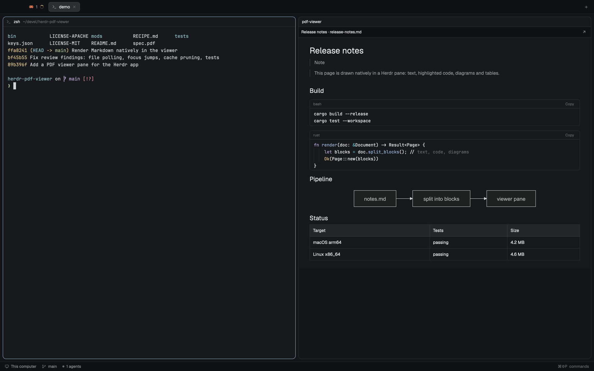

# herdr-viewer

A document viewer pane for the [Herdr](https://herdr.dev) desktop app. Run
`view spec.pdf`, `view README.md` or `view diagram.png` in a terminal, and the
file opens in a pane beside it: a PDF as a scrollable column of pages, a
Markdown file rendered as a page with highlighted code, Mermaid diagrams and
images, and an image fitted to the pane.



> [!IMPORTANT]
> **This is a personal tool, written using AI.**
> The code, tests and docs in this repo were written by an AI coding assistant ([Claude Code](https://claude.com/claude-code)).
> I directed the work, tried the tool, reviewed and decided what to keep, but I did not write it by hand.
> I built it for my own use, so expect no support, no roadmap and no stability promises.
> Read the code before you depend on it.

## Requirements

- macOS, with the Herdr app 0.1.13 or newer (`herdr-app`)
- [poppler](https://poppler.freedesktop.org) for PDFs: `brew install poppler` (provides `pdftoppm` and `pdfinfo`)
- Python 3, for placing the pane (`place.py`)
- [mermaid-cli](https://github.com/mermaid-js/mermaid-cli), only for Mermaid diagrams: `npm install -g @mermaid-js/mermaid-cli`

## Install

```sh
git clone https://github.com/slara/herdr-viewer
cd herdr-viewer
ln -s "$PWD/mods/viewer" ~/.config/herdr-app/mods/viewer
ln -s "$PWD/mods/pdf-links"  ~/.config/herdr-app/mods/pdf-links
ln -s "$PWD/bin/view" ~/.local/bin/view
herdr-app check ~/.config/herdr-app/mods/viewer
herdr-app check ~/.config/herdr-app/mods/pdf-links
```

`~/.local/bin` must come before `/usr/bin` in your `PATH`. macOS already has a
`view` command (vim, read-only); this one only takes PDF, Markdown and image
files and passes everything else to `/usr/bin/view`, so that keeps working.

For the popup that opens documents mentioned in a terminal, add this key to the
`global` section of `~/.config/herdr-app/keys.json` (it's also in this repo's
`keys.json`):

```json
"cmd-shift-o": "mod.open:pdf-links"
```

Herdr updates an untouched `keys.json` with new default shortcuts. Once you
edit it, the file is yours and new defaults have to be added by hand.

To open documents with **Cmd-click** on their path in a terminal, install the
small app that routes them (it's compiled locally, so it needs Xcode's command
line tools):

```sh
mods/viewer/router/router.py install
```

It becomes macOS's default app for PDFs, Markdown and images, and saves the
apps that opened them until now. `router.py uninstall` gives every type back
and removes it.

## Use

```sh
view spec.pdf          # beside this terminal (see "Where the viewer opens")
view README.md         # Markdown, rendered
view diagram.png       # an image: PNG, JPEG, GIF, WebP, BMP or SVG
view --tab spec.pdf    # in a new tab
```

Outside Herdr, `view` opens the file in its default app.

When the file changes on disk (a LaTeX or Typst rebuild, a save in your
editor), the viewer reloads it within about 2 seconds; a PDF stays on the same
page. The toolbar's **↗** opens the file in its default app.

### Opening a document an agent mentioned

**Cmd-click** the path (with the router installed). Herdr asks macOS to open
the file, macOS hands it to the router, and it opens in the viewer, placed the
way `view` would place it from the clicked terminal. When Herdr isn't the app
in front, the file goes to the app you used before, so Finder and other apps
behave as they always did.

Or press **Cmd-Shift-O** in the terminal: a popup lists the PDF and Markdown
files (`.md`, `.markdown`) mentioned in its output and scrollback, newest
first. Enter, a click or `1`–`9` opens one, placed the same way.

It finds absolute paths, `~/…`, `file://` URLs and names relative to the
terminal's folder, including paths an agent wrapped over two lines. Only files
that exist are listed. Paths with spaces aren't detected. A program on the
terminal's alternate screen, such as Claude Code in fullscreen mode, has no
scrollback, so only what's on screen is searched.

### Keys

Click the viewer first. In a PDF:

| Key | Action |
|---|---|
| `j` `n` `↓` `→` `Space` `PageDown` | next page |
| `k` `p` `↑` `←` `Shift-Space` `PageUp` | previous page |
| `g` `Home` / `G` `End` | first / last page |
| `+` `=` / `-` | zoom in / out |
| `0` | fit width |
| `1` | 100% |
| `r` | reload |
| `o` | open in the default app |
| `Cmd-O` | open another document |
| `Ctrl-Q` | close the viewer |

An image takes the zoom keys (`+` `=` `-` `0` `1`) and `r`, `o`, `Cmd-O`,
`Ctrl-Q`. A Markdown page scrolls with the mouse or trackpad; only `r`, `o`,
`Cmd-O` and `Ctrl-Q` apply to it. Herdr's own `Cmd-Shift-W` closes the viewer
too. Either way, a terminal it parked comes back.

To bind these elsewhere, use the `mod:viewer` section of `keys.json`, for
example `"ctrl-shift-]": "viewer.next"`. The commands are `next`, `prev`,
`first`, `last`, `zoom_in`, `zoom_out`, `fit`, `actual`, `reload`, `external`,
`pick` and `close`.

## What it shows

### PDF

Pages show as one continuous column, fitted to the pane's width, with page
navigation and zoom. Pages are rendered as they come into view, plus one on
either side.

### Images

PNG, JPEG, GIF, WebP, BMP and SVG. The image is centered and shrunk to fit the
pane, never enlarged; the toolbar shows its size in pixels and the zoom, and
past the pane's size it scrolls both ways.

### Markdown

The page is drawn natively, block by block:

- **Text** with Herdr's Markdown view: headings, lists, task lists, tables,
  quotes and links. GitHub alerts (`> [!NOTE]`) show as a label.
- **Code blocks** with Herdr's read-only code editor: syntax colors from your
  theme, selectable text, and a **Copy** button on each block.
- **Mermaid** diagrams, rendered to SVG by `mmdc` in the light or dark theme.
  The first render of each diagram takes a second or two; after that it's
  cached.
- **Images** (PNG, JPG, SVG) that sit on a line of their own, from paths
  relative to the file.

Front matter (`---` YAML or `+++` TOML at the top) is left out. Links to other
Markdown files, PDFs or images open in the same viewer; web links open in the
browser. A link to any other file only shows it in Finder: opening it could run
it, and a document may come from anywhere.

Not shown: remote (https) images, images inside a paragraph, math, and
`#heading` links within the page. Files over 1 MiB can't be read.

> [!NOTE]
> Scrolling over a code block scrolls the block, not the page, and can carry
> the code out of sight; the block snaps back when the wheel stops. Herdr's code
> editor owns the wheel and mods can't turn that off yet.

For Markdown rendered by a browser inside the terminal, with JavaScript
plugins, see [tmdview](https://github.com/slara/terminal-markdown-renderer).

## Where the viewer opens

`view` and the popup place the viewer from the terminal you used:

- **From a plain terminal (a shell):** the viewer takes that terminal's place,
  and the terminal is *parked*: off screen, still running.
- **From an agent (Claude Code or any terminal that reports an agent status):**
  the viewer takes the place of the pane on the agent's right. A viewer there is
  replaced; a terminal there is parked. With no pane on the right, the agent's
  pane is split and the viewer takes its right half.

A viewer that takes a pane's place keeps that pane's width. The toolbar's
**↩ Terminal** button puts the parked terminal back in the viewer's place;
closing the viewer puts it back beside its old neighbour.

While a terminal is parked, Herdr doesn't protect it from a herdr-core crash.

Open viewers with `view` or the popup. A viewer opened with a bare
`herdr-app do pane.split --mod viewer` isn't registered, so a later `view`
from an agent opens a new pane instead of replacing it.

## How it works

Herdr mods are JavaScript that describes native GPUI elements; there is no web
view. So:

- **PDF pages** are rasterized on demand with `pdftoppm` and drawn as images,
  at a resolution that follows the zoom and your screen's scale.
- **Markdown** is split into text, code, diagram and image blocks, each drawn
  with Herdr's own element for it.
- **Images** are copied under Herdr's folder and drawn with its image element,
  sized from the SVG's `viewBox` or from `sips`.
- **Cmd-click** goes through `Herdr Viewer.app`, a background-only app built
  from `mods/viewer/router/shim.swift` and registered as the default for PDFs,
  Markdown and images. It only forwards each file, with the app that was in
  front, to `router.py`, which opens it in the viewer if that was Herdr and in
  the previously saved app otherwise.
- **Placement** is a Python script, `mods/viewer/place.py`, that drives
  `herdr-app do`. It finds the neighbouring pane with `pane.go`; when the
  window hasn't drawn the panes yet, the tab's pane order (left first) decides.
  It records which viewer parked which terminal in
  `~/.config/herdr-app/data/viewer/state.json`.

Rendered pages are cached in `~/.config/herdr-app/data/viewer/<hash>/`, one
folder per version of a document: when the file changes, the old version's
pages are deleted. Diagrams and copies of images go to
`~/.config/herdr-app/data/viewer/md/`, since a mod can only draw images from
Herdr's folder. Anything not used for 14 days is deleted.

## Uninstall

If you installed the router, give the file types back first:

```sh
~/.config/herdr-app/mods/viewer/router/router.py uninstall
```

Then:

```sh
rm ~/.config/herdr-app/mods/viewer ~/.config/herdr-app/mods/pdf-links ~/.local/bin/view
rm -r ~/.config/herdr-app/data/viewer
```

Then remove the `cmd-shift-o` line from `~/.config/herdr-app/keys.json`.

## Development

```sh
node --test tests/                    # path detection, Markdown blocks, front matter and links
python3 -m unittest discover tests    # placement and Cmd-click routing, against fakes
herdr-app check ~/.config/herdr-app/mods/viewer
```

The mods load from this folder through the symlinks, but Herdr's hot reload
doesn't follow a symlink: after editing, close and reopen a viewer to get the
new code. The rendering itself is only tested by hand, in Herdr.

## License

[MIT](LICENSE)
