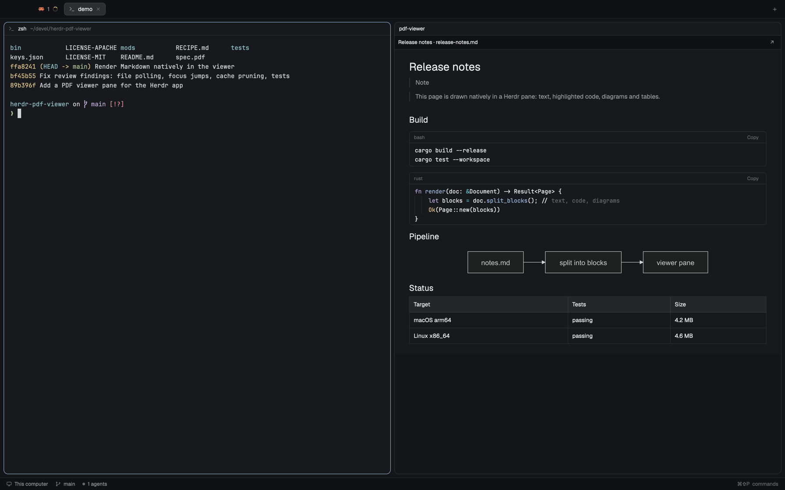

# herdr-viewer

A document viewer pane. `view file.pdf`, `view file.md` or `view image.png` in
a terminal opens the file beside it: a PDF as a continuous column of white
pages on the canvas, a Markdown file as a page of text, highlighted code,
Mermaid diagrams and images, an image centered and fitted to the pane. A Cmd-Shift-O popup lists the PDFs mentioned in a terminal and opens
one the same way.



## What you see

- **Toolbar** (32px, `chrome` background, 1px `border` bottom, 12px text): the
  document's title and file name in bold, truncated. For a PDF: `‹ 3 / 14 ›`,
  `− 90% +`, `Fit`, separated by 1px×16px `border` rules. Then `↗` (open in
  the default app) and, when the viewer took a terminal's place, `↩ Terminal`.
  Buttons are 22px tall, `muted` text, `hover` background.
- **PDF body** (`canvas`): pages centered, 18px padding around the column, 14px
  between pages, each page a white sheet with a medium shadow. A page not yet
  rendered shows `Page N` in grey; a failed one says so.
- **Markdown body** (`canvas`): a centered column at most 880px wide, 32px×24px
  padding, `background` color, 14px gaps between blocks. Text at 14px. Code
  blocks are `surface` cards with a 6px radius and a 1px `border`: a 26px
  header with the language on the left and `Copy` (then `Copied` for 1.5s) on
  the right, over a read-only editor at 13px in the terminal font, 20px per
  line. Diagrams and images are centered, at their own size, shrunk to fit.
  A diagram still rendering shows a 48px bordered box saying `Rendering
  diagram…`.
- **Image body** (`canvas`): the image centered with 18px padding, shrunk to
  fit (never enlarged). Toolbar: file name, the size in pixels (`1792 × 1121`,
  `dim`), then `− 39% +`, `Fit`, `↗`.
- **Empty pane** (no file): `No document` and an `Open document…` button
  (`solid` background) that opens the macOS file picker for PDF or Markdown.
- **Popup** (560×360, at the top, 40px down, `popover` background): `Open a PDF
  from this terminal` with `↑↓ Enter · 1–9 · Esc` on the right, then up to 8
  visible 38px rows: number, file name in bold, folder in `dim` with `~` for
  home. The selected row has the `selected` background.

## How it behaves

- PDF pages fit the pane's width by default. Zoom steps through 25%–400%; `Fit`
  returns to fit-width and keeps the current page. Keys (pane focused): `j n ↓
  → Space PageDown` next page, `k p ↑ ← Shift-Space PageUp` previous, `g Home` /
  `G End` first/last, `+ =` / `-` zoom, `0` fit, `1` 100%, `r` reload, `o` open
  externally, `Cmd-O` pick a file. An image honours the zoom keys and `r`, `o`, `Cmd-O`;
  a Markdown page only `r`, `o`, `Cmd-O`.
- Only visible pages plus one either side are rendered; while a new zoom
  renders, the previous image of the page stays up, scaled.
- The file is checked every 2 seconds; when its size or date changes, the
  document reloads and a PDF stays on its page.
- Markdown links: Markdown, PDF or image targets open in the same viewer, web links in
  the browser, other files in their default app. Front matter is not shown.
  `> [!NOTE]`-style alerts show their label as a bold line.
- Scrolling over a code block scrolls the editor; 400ms after the wheel stops,
  the block is rebuilt at its top.
- Placement (`view` and the popup), from the asking terminal: a plain shell is
  replaced by the viewer and parked; from an agent (a terminal with an `app` or
  status), the pane on its right is replaced (a viewer closed, a terminal
  parked), or the agent's pane is split right. A viewer taking a pane's place
  keeps that pane's width. Closing the viewer gives the parked terminal back
  beside its old neighbour; `↩ Terminal` gives it back in the viewer's place.
  Focus returns to the asking terminal (or the new viewer, from a shell).
- The popup reads 2,000 lines of the focused terminal, newest mention first,
  joins paths an agent wrapped across lines, resolves `~`, `file://` and paths
  relative to the terminal's folder, and lists only files that exist. Enter, a
  click or `1`–`9` opens one; Esc closes.

## Built from

- **Mods:** `mods/pdf-viewer` (`mod.json`: `{"place": "none", "focusable":
  true}`), a pane mod opened with `pane.split {mod: "pdf-viewer", props: {file,
  id, parked?}}`; `mods/pdf-links` (`{"place": "none", "overlay": {"kind":
  "popup", "at": "top", "offset": 40, "width": 560, "height": 360}}`), opened by
  `mod.open:pdf-links` on `cmd-shift-o`.
- **PDF:** `pdfinfo -f 1 -l 100000` for page sizes (rotation applied) and title;
  `pdftoppm -png -r <dpi> -f n -l n -singlefile` per page into
  `data/pdf-viewer/<sha1 of path+mtime+size>/p<n>-<dpi>.png`, written to a
  temp name and moved into place. DPI = scale × 72 × 2, rounded to 24, clamped
  48–600. Pages are a `v_virtual_list` with per-page heights and a
  `VirtualListScrollHandle`; a 150ms timer reads the visible range the
  renderer recorded and renders one missing page at a time.
- **Markdown** (`doc.js`): split into `md`, `code`, `mermaid` and `image`
  blocks (fences, standalone `` lines). Text: `TextView.markdown`,
  selectable, `on_link_click`. Code: `EditorState.new({language, readonly: true,
  line_numbers: false, folding: false, syntax: {keyword: ansi5, string: ansi2,
  comment: dim, function: ansi4, type: ansi3, number: ansi1, constant: ansi6}})`
  with fence names mapped to extensions (`rust`→`rs`, `bash`→`sh`, …); Copy uses
  `cx.write_to_clipboard`, falling back to `pbcopy`. Mermaid: `mmdc -i x.mmd -o
  x.svg -t dark|default -b transparent -c {"htmlLabels": false}`, cached by
  sha1 of source and theme. Images: copied to `data/pdf-viewer/md/`, size from
  the SVG `viewBox` or `sips -g pixelWidth -g pixelHeight`, drawn with
  `image()`.
- **Placement** (`place.py`, run by `bin/view`, the popup and the viewer's
  `close()`): `herdr-app ls`, `herdr-app status`, `herdr-app do` with
  `pane.focus`, `pane.go` (to find neighbours), `pane.split`, `pane.swap`,
  `pane.close`, `terminal.park`, `terminal.keep`, `tab.new`. State in
  `data/pdf-viewer/state.json` under `fcntl` lock: viewer id → pane, tab, file,
  parked terminal, anchor pane.
- **Image:** the same copy-and-size path as Markdown images; fit scale is
  `min(1, (width − 36) / w, (height − 32 − 36) / h)`, from the root's
  `on_size_change`; zoomed past the pane, an `overflow_scroll` area with
  `Scrollbar.new`.
- **CLI** `bin/view`: one `.pdf`/`.md`/`.markdown`/image argument inside Herdr
  (`$HC_TERMINAL_ID` set) runs `place.py`; outside Herdr, `open`; anything else
  goes to `/usr/bin/view`.
- Programs it runs: `pdfinfo`, `pdftoppm`, `mmdc`, `sips`, `stat`, `mv`, `cp`,
  `find` (cache cleanup after 14 days), `open`, `osascript` (file picker),
  `pbcopy`, `python3`, `hc read` (popup).

## Watch out

- No web view: TextView doesn't color code (`TextView.html` ignores inline
  styles too) and draws no images at all, so code and images need their own
  blocks.
- gpui's SVG renderer skips `<foreignObject>`: Mermaid labels vanish unless
  `htmlLabels` is false.
- `image()` only reads under the app home, so images and diagrams are copied
  there.
- The read-only Editor scrolls itself, past its last line, and keeps the wheel;
  there's no option to stop it. The page doesn't scroll over a code block.
- A popup sizes to its content: give the list an explicit height or it
  collapses to the header.
- `pane.go` and `pane.swap` work from geometry the window computes only while
  it draws; a hidden window has none. Placement falls back to the tab's pane
  order, and a replacement then keeps only half the replaced pane's width.
- A split halves the pane and a closed pane's space goes to the pane before it;
  to inherit a pane's width, split it right, swap the new pane left, then
  close or park the old one.
- `terminal.keep` can answer `pending` and move focus later; wait for the pane
  before refocusing.
- A pane mod doesn't know its own pane id; that's why `place.py` keeps state.
- `watchFolder` is recursive on macOS; poll the file's `stat` instead.
- Herdr's hot reload doesn't follow symlinked mod folders.
- macOS only (`stat -f`, `sips`, `open`, `osascript`, `pbcopy`).

## Done when

- `herdr-app check` passes for both mods; `node --test tests/` and
  `python3 -m unittest discover tests` pass.
- `view some.pdf` from a shell beside Claude Code replaces that shell; the
  first page appears fitted to the width; `j` moves to page 2; `+` zooms and the
  page re-renders sharp; `↩ Terminal` brings the shell back at the same width.
- `view some.pdf` from Claude Code alone opens a viewer at half its width;
  `view other.md` from Claude replaces it without a third pane.
- `touch some.pdf` reloads the viewer within 2 seconds on the same page.
- A Markdown file with a ```rust block, a ```mermaid flowchart and a relative
  PNG shows colored code with a working Copy button, a diagram with its labels,
  and the image fitted to the column; front matter is hidden.
- In Claude Code, after it prints a PDF path, Cmd-Shift-O lists that file
  first and Enter opens it.
