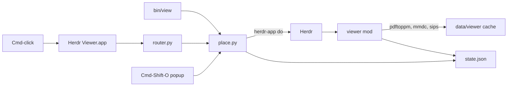

# Architecture

This page explains how herdr-viewer works, for anyone reading or changing the
code. The project is about 1,500 lines in eight files: JavaScript for the two
Herdr mods, Python for placing panes and routing Cmd-clicks, a little Swift for
the macOS side, and a shell script for the `view` command.

## The constraint everything follows from

Herdr mods are JavaScript that describe native GPUI elements. There is no web
view, no HTML or CSS, and a mod can only draw images that live under Herdr's own
folder (`~/.config/herdr-app`). A mod also can't find out its own pane id, and
it can't intercept a click on a terminal link.

So:

- PDF pages are rasterized to PNG by poppler's `pdftoppm` and drawn as images.
- Markdown is split into blocks, and each block is drawn with the native
  element that fits it.
- Every image the viewer shows is first copied under Herdr's folder.
- Placing panes is done from outside the mod, by a Python script that drives
  `herdr-app do` and keeps its own record of which pane is which viewer.
- Cmd-click works through macOS itself: a small app becomes the default for
  these file types and sends files from Herdr back to the viewer.

## What happens when you run `view spec.pdf`

1. `bin/view` asks `router.py kind spec.pdf` whether the viewer shows that
   file. If not, it runs the system's `/usr/bin/view` (vim) instead.
2. Inside Herdr (`$HC_TERMINAL_ID` is set), it runs `place.py spec.pdf`.
3. `place.py` finds the terminal it was run from in `herdr-app ls`, decides
   where the viewer goes (see [Placement](#placement)), and opens a pane with
   `herdr-app do pane.split {mod: "viewer", props: {file, id, parked}}`.
4. It records the new viewer in `data/viewer/state.json`, and parks the
   terminal the viewer replaced, if any.
5. Herdr starts the `viewer` mod in that pane. It runs `pdfinfo` for the page
   sizes, and a timer renders the pages that come into view with `pdftoppm`.
6. Every 2 seconds the viewer checks the file's date and size. When they
   change, it reloads the document and stays on the same page.

## Files

| File | Job |
|---|---|
| `bin/view` | The `view` command: hands supported files to `place.py`, everything else to `/usr/bin/view` |
| `mods/viewer/main.js` | The viewer pane: loads a document, renders it by kind, toolbar, keys, reload, cache cleanup |
| `mods/viewer/doc.js` | Pure helpers with no Herdr imports: file kinds, Markdown blocks, front matter, links, SVG size |
| `mods/viewer/place.py` | Where a viewer goes, parking terminals and giving them back, `state.json` |
| `mods/viewer/router/router.py` | Cmd-click support: builds and installs the app, routes files, holds the list of supported types |
| `mods/viewer/router/shim.swift` | The macOS app: forwards "open documents" events to `router.py`, reads and sets default apps |
| `mods/pdf-links/main.js` | The Cmd-Shift-O popup: reads the focused terminal and lists the documents it mentions |
| `mods/pdf-links/paths.js` | Finds PDF and Markdown paths in terminal text, including paths wrapped over two lines |

`doc.js` and `paths.js` import nothing from Herdr, so `node --test` can run
them. `place.py` and `router.py` are tested with fakes in place of `herdr-app`.

## The viewer

`main.js` is one View class. A document is one of three kinds, decided by its
extension in `doc.js`:

| Kind | Loaded with | Drawn with |
|---|---|---|
| PDF | `pdfinfo` for page sizes, rotation and title | A `v_virtual_list` of pages; each page is a PNG from `pdftoppm` |
| Markdown | `readTextFile` (up to 1 MiB) | Blocks from `splitMarkdown`: `TextView.markdown`, a read-only `Editor`, `image()` |
| Image | Copied under Herdr's folder; size from `sips` or the SVG `viewBox` | One `image()`, fitted to the pane |

**PDF pages.** The virtual list only builds the rows on screen, and records the
visible range. A 150 ms timer reads that range and renders one missing page at a
time: the visible ones, then one on either side. The resolution follows the zoom
for a 2× (Retina) screen, rounded to steps of 24 dpi so a resize doesn't
re-render every page. Each PNG is written under a temporary name and moved into place, so
the image loader never reads half a file. While a page re-renders at a new zoom,
the previous image stays up, scaled.

**Markdown blocks.** `splitMarkdown` cuts the text at fenced code blocks and at
images on a line of their own:

- Text runs go to `TextView.markdown`, which handles headings, lists, tables,
  quotes and links but colors no code and draws no images.
- Code blocks go to a read-only `Editor`, which highlights syntax with the
  theme's colors. A Copy button sits in each block's header.
- `mermaid` blocks are rendered to SVG by `mmdc`, with `htmlLabels: false`,
  because GPUI's SVG renderer skips the HTML labels Mermaid uses by default.
- Images are copied under Herdr's folder and drawn with `image()`.

**Keys and focus.** Herdr focuses a pane on the first click, but the mod only
hears the second. So every 150 ms the viewer compares Herdr's focused pane with
its own, which it reads once from `state.json`, and takes the keyboard when they
match.

**Links.** A link to Markdown, a PDF or an image opens in the same viewer. A web
link opens in the browser. A link to any other file is only revealed in Finder,
because opening it could run it.

## Placement

`place.py` decides where a viewer goes, from the terminal that asked:

- **A plain terminal (a shell):** the viewer takes that terminal's place, and the
  terminal is parked with `terminal.park` (off screen, still running).
- **An agent** (a terminal Herdr reports an `app` or a status for): the viewer
  takes the place of the pane on the agent's right. A viewer there is replaced;
  a terminal there is parked. With nothing on the right, the agent's pane is
  split.

**Finding the pane on the right.** Herdr has no geometry API, so `place.py`
moves focus with `pane.go right` and reads which pane got it. A pane gets
geometry only once the window has drawn it, so when the window is in the
background `pane.go` finds nothing. Then the tab's pane order, left first, decides.

**Keeping the width.** Splitting a pane halves it, and when a pane closes its
space goes to the pane before it. To take a pane's full width, the viewer is
split off to its right, swapped to its left with `pane.swap`, and then the old
pane is closed or parked, so its space goes to the viewer. `pane.swap` also
needs drawn geometry, so it waits for the new pane to appear beside the old one.

**Giving terminals back.** When a viewer closes, its `close()` runs
`place.py --closed <id>`, which puts the parked terminal back beside the pane
recorded with it, or as a new tab if that pane is gone. The ↩ Terminal button
runs `place.py --restore <id>`, which puts it back in the viewer's place, with
the same swap.

**State.** `data/viewer/state.json` maps each viewer's id to its pane, tab,
file, parked terminal and anchor pane. It's read and written under an `fcntl`
lock, because a viewer closing runs `place.py --closed` while another
`place.py` may be replacing it. When one viewer replaces another, the old entry
is deleted before the old pane closes, so its `close()` finds nothing to give
back and the new viewer inherits the parked terminal.

## Cmd-click

Herdr opens a Cmd-clicked path the way macOS opens any file: with the default
app for its type. `router.py install`:

1. compiles `shim.swift` into `~/Applications/Herdr Viewer.app`, writes its
   `Info.plist` (background-only, claims PDF, Markdown and image types), signs
   it ad hoc and registers it with Launch Services;
2. saves the current default app for each type in `state.json`;
3. makes the shim the default for each type.

When macOS opens a file with the shim, the shim notes which app is in front and
runs `router.py open --front <bundle id> <files>`. If that app is Herdr, the
file opens with `place.py`'s rules from the focused terminal. Otherwise it goes
to the saved previous app, so Finder and other apps behave as before.

macOS takes default-app changes from different APIs depending on direction: an
app can make itself the default through `NSWorkspace`, and give a type to
another app through `LSSetDefaultRoleHandlerForContentType`. Each one fails or
does nothing in the other case, so the shim's `set` uses both.

The viewer's ↗ button also goes through `router.py`, because with the shim
installed a plain `open` would come straight back to the viewer.

## The popup

Cmd-Shift-O opens `pdf-links` as a popup. It reads up to 2,000 lines of the
focused terminal with `hc read`, finds PDF and Markdown paths with `paths.js`,
keeps the ones that exist on disk (in one shell call), and lists them newest
first. Choosing one runs `place.py --from <terminal>`.

Agents hard-wrap long paths, so the path pattern allows a line break plus the
next line's indentation inside a path. A match that crosses a break might also
be prose glued to a path, so every tail after a break is offered too, and the
disk check keeps the real one.

## On disk

Everything lives under `~/.config/herdr-app/data/viewer/`:

| Path | What | Cleaned |
|---|---|---|
| `<hash>/p<page>-<dpi>.png` | PDF pages, one folder per version of a file | At once when the file changes, or after 14 days unused |
| `md/` | Mermaid SVGs, copies of images | Per file, after 14 days unused |
| `state.json` | Viewers, parked terminals, saved default apps | Entries removed as viewers close |

## Design choices

- **A stat poll, not a file watcher.** Herdr's `watchFolder` is recursive on
  macOS: watching the folder of a PDF in your home would watch the whole home.
  A `stat` every 2 seconds costs one small process.
- **Placement in Python, not in the mod.** The mod can't learn its own pane id,
  and placement needs several `herdr-app` round trips with waits in between.
  A script also serves `view`, the popup and Cmd-click alike.
- **A thin shim.** All the Cmd-click logic is in `router.py`, next to
  `place.py`, where it's tested. The Swift side only receives events and
  calls Launch Services.
- **Native blocks over a browser.** A terminal browser can render HTML with
  JavaScript plugins, but in Herdr it's slow. Native elements are fast, at the
  cost of what they can't do.

## Known limits

- Scrolling over a code block scrolls the editor, not the page: Herdr's
  `Editor` keeps the wheel and has no option to stop. The block snaps back to
  the top when the wheel stops.
- `TextView` draws no images, so only images on a line of their own are shown.
- `pane.go` and `pane.swap` need the window drawn; with it in the background, a
  replacement keeps only half the replaced pane's width.
- Herdr's hot reload doesn't follow symlinked mod folders: reopen a viewer after
  editing.
- macOS only: `stat -f`, `sips`, `open`, `osascript`, `pbcopy`, and the shim.
